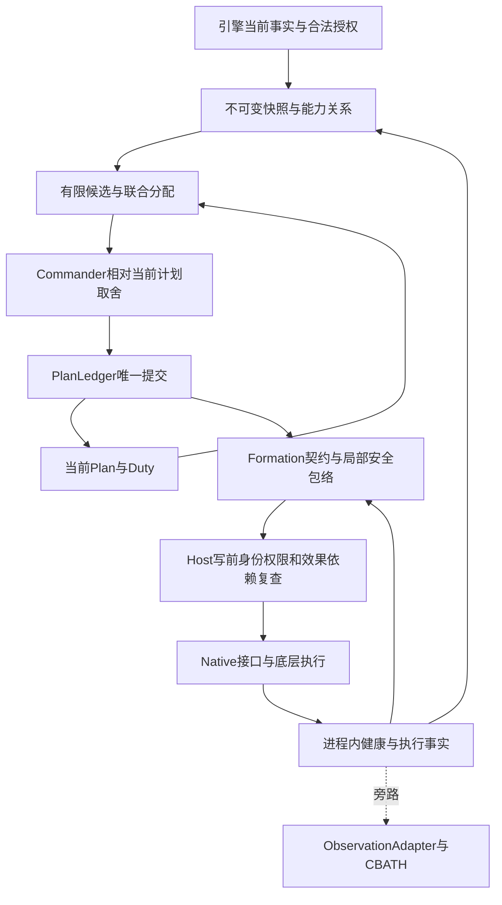

> **研究资产阅读视图**：原件位于 [CombatBrain_Research_2026-10-22.zip](../archives/CombatBrain_Research_2026-10-22.zip)，包内路径为 `主报告.md`。本视图只增加说明并调整指向省略文件的 Markdown 链接；代码保持原样。完整复现请在原 ZIP 的独立解压副本中运行。研究建议未自动获批。

# CombatBrain 2.0：战术决策闭环研究与验证

日期：2026-10-22（Asia/Shanghai）｜独立研究交付｜不改变生产代码、现行 P3 合同或历史验收。

**RECOMMENDED：保持已签收的 Commander/Formation 架构；把“根据远程人数比例生成固定职责”增强为“从支援与到达时间产生任务候选，联合分配有限协同包，重估当前计划，再用职责效果反馈修补”。首批求解器采用带硬约束的两队成包贪心，小候选集合可直接枚举；暂不以 beam、HTN 全面重写或战斗前滚替换现有框架。**

这是根据本轮实验收缩后的推荐。36 个未逐例调参的构造问题中，成包贪心全部达到该候选域的枚举参照；beam 达到 34 个，且平均调用效果评估器更多。这里的参照只优化公开的抽象能力账本，**没有证据证明新算法优于当前完整 CB2，更没有游戏胜率或战损改善证据**。最值得先实现的是条件机会、资源/时窗约束与反馈接线，而不是搜索深度。

## 1. 实质增量与结论边界

| 原缺口/上限 | 本次具体机制 | 结果及证据层级 | 对智能/稳定/实现的贡献 | 未验证依赖/风险 |
|---|---|---|---|---|
| CB2 `BuildCoordination` 的固定三职责与远程比例门，缺少可比较的目标—执行者组合 | 从真实成员能力、几何、通路、弹药、支援 ETA 生成候选；同一编队在窗口内只承诺一种主动作；固定/利用可成包改变 | **第一层**约束反例；**第二层**构造状态下能在侧击、攻击支援者、保护和保持之间改变分配 | 实际产生并分配协同组合，不是预置计划分数表 | 能力、射界、路径、支援效果均无引擎校准 |
| 看到弓兵弱点不等于侧击机会 | 支援到达筛查、牵制启动与可持续终点、攻击窗口交集；执行时另查已观察的准备/牵制效果 | 迟到牵制、无法移动的支援者、多依赖推迟窗口均有反例；是**第一层模型性质** | 把“有弱点”“能利用”“已产生效果”分开 | 真实敌队能否被牵制、多久失去支援能力仍待测；原型条件较保守 |
| 独立任务分配容易重复占用保护/预备力量 | 关键 Duty 强制覆盖；任务取消不删除 Duty；预备队响应预算只给一个资产；敌方输出预算跨受击者共享 | 修复了本轮原型中的预备队重复计量、敌火力重复计量；30 项回归通过 | 避免用虚假的支援/火力“创造”协同收益 | 预算分配是抽象近似；没有模拟真实目标选择 |
| 旧版缓存当前分数、候选共享保持计时；CB2 后继路径仍专项化 | 当前安排在同一新快照/剩余窗口重估；显式转换成本、硬失效越过保持、无反应/阻路反馈改变候选 | **第一层**旧令/身份/硬失效反例；**第二层**反馈轨迹；切换成本消融本轮**未显示收益** | 有可接续的决策闭环，避免拿旧分数作现状 | 脱离/转向/展开成本尚为代理量；真实双端振荡未验证 |
| 高级搜索容易先于可信数据进入系统 | 相同候选、效果模型和额外评估调用上限，对比成包贪心、beam、无预算小问题枚举 | **第二层负结果**：默认保留更简单方法；公开剪枝差距与敏感性 | 删除未证明值得的复杂度 | 3 个己方编队样本很小，不证明大规模优越性 |
| 新健康反馈可能与 `PlanLedger`、Host 后继路径竞争 | 提供单一提交口、Task/Duty、身份与新鲜度、旁路日志隔离的候选合同 | 静态审计 + 原型有限合同测试；C# 迁移是**规格** | 使决策可接入现有系统，避免再造状态机 | 未执行 C# 构建、Native 接入、Campaign/F6 或重编 |

三层证据严格分开：①逻辑与约束在所列输入/模型范围内成立；②抽象目标下的决策表现；③真实引擎中的战术收益与运行表现。本轮③全部 **NOT_RUN / NEEDS_ENGINE_EVIDENCE**。静态源码事实与历史报告不自动升级为①或③的新验证。

## 2. 冻结基线、能力覆盖与主攻选择

### 2.1 访问与能力

四库均通过公开 GitHub 与已授权 `gh` 可读，启动后按提交冻结，不追逐后续分支变动。独立快照保存在 `sources/`；完整来源身份见 `evidence/cb2_identity.json`、`evidence/legacy_source.json`、各 `SNAPSHOT_IDENTITY.json`。本机 Python 3.13.7 / macOS 26.2 arm64 可执行；未找到 `dotnet`，没有游戏/目标 DLL，没有安装或伪造引擎环境。

| 来源 | 分支 | 本轮冻结 SHA |
|---|---|---|
| CombatBrain-2.0 默认 | `master` | `2138038cef53216118d445d37c5245b1bef019db` |
| CombatBrain-2.0 研究 | `research/requirements-clarification-20261021` | `dd28965238a83c29ae824f7225d90e3b2c8bfce4` |
| Bannerlord-CombatBrain | `main` | `e30a3543f3a249ac458b0894bfc1fd7a17a17f2d` |
| TacticalCommandLab 默认 | `master` | `c86167a887cb3c1691dd12fa2d19385d937e8364` |
| TacticalCommandLab 实验 | `codex/local-phase10-verification-20261006` | `a4524aa1cad75f085ad9c866a4dda457dfd6ad49` |
| Bannerlord-CBATH | `main` | `acbd5d94a45770bdeaa046f24a72b4d803054388` |

CB2 两份快照的 `Program/` 文件逐一比对相同；研究分支新增决定不是新增生产能力。已完整读取主台账及增量、跨文档审计、交接、三份 charter 基线；Charter 文件名 V0.2、文内 **v0.3**，Roadmap 文件名 v0.1、文内 **v0.2**，Requirements 截止 **2026-10-20**。随后定向核对 D-EVAL/D-CAP/D-PRED/IF-FEEDBACK、相关架构和实际源码。

最新有效裁决采用台账后续章节：§K 已签收 D-EVAL 架构，§M 要求真实游戏数据主导校准，§O–P 确定最高 Tactics 与合法域，§S 确定 CB 独占战术决策，§U–W 确定职责、安全包络与牺牲优先，§X 签收独立健康维度。早期“下一题 D-EVAL”“普通任务让 Native 自由选战术”“军团是否首版 OPEN”均不能覆盖这些增量。[CB2 台账](https://github.com/Lzq061122/CombatBrain-2.0/blob/dd28965238a83c29ae824f7225d90e3b2c8bfce4/research/requirements-clarification-2026-10-21/CombatBrain-2.0-Confirmed-Design-Ledger-2026-10-22.md)

CB2 `AGENTS.md` / registry 的 ACTIVE 入口已核；只读研究身份不执行旧派单。1.x 外置 Windows 登记表不可访问，按本次明确只读授权继续，未声称满足其生产流程。各库规则与生产/冻结边界记录于审计附录。

### 2.2 四库机制与复用判断

| 来源/层 | 已有机制与实际证据 | 复用程度 | 对 2.0 的真正缺口 |
|---|---|---|---|
| CB2 感知/规划 | **静态** `BattleAssessment.Read` 取首个玩家/非玩家 Team；`BattleState` 人数、步弓比例、中心；`BuildCoordination` 首个稳定序候选为 Main，Guard/Support 就近分配 | 保留快照、身份、几何/读回基础；改造输入与规划 | 能力相性、混编、支援关系、可用机会、资源机会成本没有形成通用闭环 |
| CB2 执行/反馈 | **静态** `FormationTask` 有对象/版本/有限依赖；`TaskFeedback` 检验命令族、位移/读回；Host `ActionFeedbackStep` 可触发后继；P0–P2 有限定历史合同，P3 仍未通过 | 保留有限执行证据，不把其专项分数或 Stop 路线普遍化 | 任务效果、持续 Duty、单一通用重评和可靠 Native 交还 |
| 1.x | **静态** 固定九意图线性打分、邻近聚类、按兵种任务映射、ETA 投入门、骑兵波次、命令仲裁；本次运行 Node 契约自测 35/35 | 聚类、几何和仲裁契约可提取/改造；意图选择、伪机会、旧 Fog/Agent 路线不直接搬入 | 支援没有资源占用，目标/时窗组合不足；旧代码还存在单位/时间/身份缺陷 |
| TCL | **静态 + 历史实测转述/派生物复核**：逐命令域 Hook；局部 Movement/HOLD；Release/恢复实验；本轮核验 12 派生文件哈希 | 复用逐域测量和交还反例，不复制其常态 Native 仲裁路线 | 全域写入口、真实任务保持、F6、异常/到期恢复没有覆盖 |
| CBATH | **静态 + 有限历史原始时间序列**：启动、CustomBattle、身份、主线程调用、1 Hz 采样；较早 373 点记录间隔 1.000–1.029 秒 | 保留冻结基础，按具体实验增最小采集 | Campaign 链、部分 F6、实例代数、职责效果、长战截断、真实目标对象等仍缺 |

主要源码定位：[CB2 BattleAssessment.cs L143](https://github.com/Lzq061122/CombatBrain-2.0/blob/dd28965238a83c29ae824f7225d90e3b2c8bfce4/Program/src/Core/BattleAssessment.cs#L143)、[TaskFeedback.cs L19](https://github.com/Lzq061122/CombatBrain-2.0/blob/dd28965238a83c29ae824f7225d90e3b2c8bfce4/Program/src/Core/TaskFeedback.cs#L19)、[PlanLedger.cs L38](https://github.com/Lzq061122/CombatBrain-2.0/blob/dd28965238a83c29ae824f7225d90e3b2c8bfce4/Program/src/Core/PlanLedger.cs#L38)、[Host 后继触发 L170](https://github.com/Lzq061122/CombatBrain-2.0/blob/dd28965238a83c29ae824f7225d90e3b2c8bfce4/Program/src/Host/TestDriver.ActionFeedback.cs#L170)。四库详细证据在 [legacy_audit](evidence/legacy_audit.md)、[native_audit](evidence/native_audit.md)、[integration_spec](evidence/integration_spec.md)。

重要校正：TCL run04–11 原始归档没有进入当前 Git 快照；24.50 秒 HOLD、窗口内 49 次拒绝、G3 FAIL 是历史记录的限定结论，本轮只核派生文件及 ABA 37/35，不能称原始实测重跑。CBATH 最终 `zt-*.json` 同样缺失，冻结 3/3 只能标 DOC/转述；早期373点记录不能替代该批次。CBATH 整队 `SetControlledByAI(true,false)` 不是部分 F6 授权证明。[TCL 收口](https://github.com/Lzq061122/TacticalCommandLab/blob/a4524aa1cad75f085ad9c866a4dda457dfd6ad49/docs/phase10-closure-20261007.md#L9)、[CBATH 冻结基线](https://github.com/Lzq061122/Bannerlord-CBATH/blob/acbd5d94a45770bdeaa046f24a72b4d803054388/RD/CombatBrain-Autonomous-Test-Harness/16-Phase2-Freeze-CBATH-Baseline.md)

### 2.3 覆盖图与优先级

| 能力 | 当前可提取实现 | 已确认方向但未实现/未验证 | 本次处理 |
|---|---|---|---|
| 战场理解 | 计数、中心、有限身份/成员聚合 | 画像、混编、射界、前沿、能力关系 | 主链所需能力/ETA输入；不造地形引擎 |
| 机会/主动性 | 简单比例条件；1.x 有机会名与局部门 | 条件可利用机会、有限施压 | 实现候选、支援筛查、有限 probe 与失败记忆；僵局主动选择仍弱 |
| 多阶段协同 | 三职责依赖/几何 | 作用条件、覆盖时间窗、失败分支 | 主攻固定→利用的有限依赖、执行 readiness、失效修补 |
| 分配/资源 | 稳定序主力、保护优先几何 | 攻击/保护/预备竞争、增援和重编成本 | 主攻联合分配；未入场援军不进入资源集 |
| 预测/适应 | P3 专项局部损失 | 任务条件化效果、少量反应 | 静态效果账本、三情景、当前计划重估、反馈闭环 |
| 稳定/性能 | 重试记忆、版本、计划期限 | 统一承诺、局部修补、预算退化 | 原型与反例；实际帧预算待测 |
| 权限/重编/宿主 | 非玩家有限控制证据 | 双端F6、军团、真实重编、安全交还 | 接口规格/最小探针，首版缺口保留 |

选择这条主线因为它同时决定“想得到什么战术”“有没有部队完成”“值得不值得从当前任务改派”。补更多战术名称无法解决这个上限。控制可靠性是执行阻塞，但本机可以把它作为 capability 前提继续纯 Core；没有理由把本轮转成只验证 Token/消息。反证条件是：实机显示现有固定职责已覆盖目标场景、支持关系无法可靠读取、牵制不足以改变敌支援，或组合搜索相对简单方案始终无增量；届时保留基础约束和简单分配，减少预测/组合复杂度。

## 3. 外部研究如何改变技术选择

检索日期均为 2026-10-22，查询、读到正文的范围、排除项、来源哈希保存在 [external_research](evidence/external_research.md)。没有根据 Defilade/Total War 演示推断内部架构。只借机制，不复制未经授权源码。

| 原始来源与机制 | 对应缺口、采用/排除判断 | 代价与最小验证 |
|---|---|---|
| Straatman/Champandard，*Killzone 2 Multiplayer Bots*，2009-06-11，官方 slides p15–16 的 continue branch、p39–40 的启发式分配 | **采用**当前计划继续分支与可行性抢占；不能因 HTN 名称就声称全局分配更优；FPS掩体/5 Hz不迁移 | 一致重估和转换成本；小幅新优势保持、硬依赖失效立即重评。[官方正文](https://www.guerrilla-games.com/media/News/Files/GAIC09_Killzone2Bots_StraatmanChampandard.pdf) |
| Guerrilla，*The AI of Horizon Zero Dawn*，2017-10-17，p22–26 的带人数限制角色 Utility 与 HTN 分解 | **采用**强简单分配基线；HTN与Utility处于不同层，全面重写 **延期** | 同候选对比贪心与组合；不引入攻击者上限或玩家节奏规则。[官方正文](https://www.guerrilla-games.com/media/News/Files/The-AI-of-Horizon-Zero-Dawn.pdf) |
| Gerkey/Matarić，*A Formal Analysis and Taxonomy of Task Allocation in Multi-Robot Systems*，2004，§1.1/§3/§5.1 | 独立匹配不涵盖任务排序/互补；**采用问题界定**，不把匈牙利算法最优性外推全 Commander | 独立职责可匹配；牵制—侧击必须联评；不用分布式拍卖。[原论文](https://www2.cs.sfu.ca/~vaughan/teaching/415/papers/gerkey-mrta.pdf) |
| Churchill/Buro，*Portfolio Greedy Search and Simulation for Large-Scale Combat in StarCraft*，2013；Ontañón，*Combinatorial Multi-Armed Bandits for RTS Games*，2017 | 借有限动作抽象、联合合法性、可中断改进；**延期 rollout/MCTS/训练**，因为当前无可信转移模型，单坐标改进也可能漏互补组合 | 同候选穷举小问题反查；不迁移其耗时、单位规模和战斗成绩。[PGS原文](https://davechurchill.ca/publications/pdf/combat13.pdf)、[CMAB原文](https://arxiv.org/pdf/1710.04805) |
| Dechter/Meiri/Pearl，*Temporal Constraint Networks*，1991，§3 | **采用**时间差/覆盖约束表示；先用有限依赖，不引入完整STN/STNU | 联合窗口无交集必须拒绝；可满足时间约束不代表敌人允许其实现。[原论文](https://ics.uci.edu/~dechter/publications/r10.pdf) |
| RBM，固定 `7f9069b6e111c7ce124f07545f0edef8202042bf`，2026-10-06 | **采用机制**：有界出击、召回、散离检查、冷却和Tactic/Behavior接入经验；不迁移Agent逻辑/文化固定战略/Campaign自动结算强度 | 核出击失败和返回，逐域验API；未发现LICENSE，故独立实现。当前骑兵源码与旧手册不同，依据代码限定事实。[FlankBehaviors](https://github.com/Fellow93/RealisticBattleProject/blob/7f9069b6e111c7ce124f07545f0edef8202042bf/RealisticBattleAiModule/AiModule/Behaviors/FlankBehaviors.cs#L283) |

### 3.1 同条件路线比较

共同输入是合法当前快照、同一能力/关系边、同一有限动作和执行保障；不是让高级算法多看信息。设 F 为可用编队，C 为每队可选动作上限，S 为反应数，E 为相关关系边，B 为额外效果评估调用预算。

| 路线 | 能表达什么 / 主要失败 | 预算与C#接入 | 最终判断 |
|---|---|---|---|
| 当前 CB2 的限定计划 | 固定三职责、几何及专项后继；不能公平映射成全新任务集下完整对战者 | 已在现有工程；保留历史合同 | **保持基线**，只做可忠实复现的小子问题对照 |
| 独立 Utility/匹配 | 一队一独立职责；难表达互补与时窗 | 排序或 O(N³) 匹配；无需新增框架 | 可作廉价独立子问题，不单独承担组合 |
| **两队成包贪心** | 每轮枚举单队/双队替换，完整硬约束与全局效果一起算；能含fix+strike，三队互补仍可能卡住 | 两轮上界 O(F²C²) 次评估，惰性生成且 B 截断，始终保留可行当前/保障安排 | **首批默认推荐**，本轮36例匹配参照；不是普遍最优 |
| beam 联合分配 | 层层组合，能搜索更多联合方案；部分解启发式会剪掉稍后才兑现的依赖 | 最坏 O(F·W·C) 部分展开，额外补全评价也计预算；C#可直接写数组/列表 | **保留挑战者**；本轮34/36、比贪心更多评估，没有默认采用依据 |
| 手工HTN+分配 | 分解和执行阶段明确；方法库限制战术覆盖，资源问题仍要另解 | 分支/回溯须有界；迁移成本高 | 现有任务执行可用此思想，**不重写框架** |
| 滚动前滚/PGS/CMAB | 能看持续后果，也会更精确优化错误模型 | 每候选多次转移/评估，缺可信模拟器/训练数据 | **延期**，不扩为新战斗模拟器 |

小问题枚举的上界为 C^F，只作离线参照。原型评估中部分支援与候选关系仍扫描相关敌 Formation，并非已经实现生产稀疏索引；生产应在快照更新时构建 O(E) 缓存，每个候选只访问关联边。不能把 F/E 数学上限外推万人游戏帧时间。

## 4. 推荐闭环与可实现算法

### 4.1 输入、任务词汇和效果账本

`DecisionSnapshot` 使用米、秒、实际存在的 Formation 与成员聚合；身份含 Battle/LegalDomain/FormationGeneration/AuthorityGeneration、成员版本和观测时刻。能力画像按真实子群加和，远程只按具备远程能力成员×残弹，混编不会全部算成弓兵。未知兵种使用显式通用非零估计与更宽区间；画像/规则版本不匹配则降级。Vanilla/RBM 分开参数，不采用文化标签替代能力。

几何直线距离在原型仅是合成场景的路径假设；生产 `PathFact` 必须给长度/可达性/宽度/坡度和 age，射界须真实读取或探测。ETA采用区间：路径长度÷有效编队速度＋转向/展开/离开原任务的未来成本。已观察到正在生效的同目标任务不再计一次展开；已付历史伤亡是沉没成本，不重复扣除。路径未知不能变成“无阻碍”。

| 建议最小任务语义 | 前提/职责/局部动作 | 依赖、效果与退出 | 原生命令需求与原型映射 |
|---|---|---|---|
| 维持/保护 `Maintain/Protect` | 对象/区域、必要覆盖；足够拦截能力；在职责包络内朝向/队形/小幅位置调整 | 接任者作用被观察到才解除旧承担；不能以站到点单独证明保护收益 | Move/Stop、Facing/Arrangement按实际动作；`hold/protect` |
| 牵制/限制支援 `Fix` | 指定敌对象或通路；可达、可持续、与任务相性匹配；允许有限接战/防御 | 观察对方行动/火力/支援通路确受影响；高损失但有效不自动失效 | Move/Engage及必要阵型；`fix` |
| 打击/利用 `Engage/Exploit` | 指定目标、预计可用窗口；依赖支撑已分配且执行可证 | 利用型侧击在依赖有效后放行；对方补防、窗口关闭→局部修补/重评 | Move/Charge等候选API逐项待证；`strike` |
| 火力/施压 `Fire/Pressure` | 有效远程子群、残弹、射界；限定暴露与职责影响 | 指定持续时段与停止条件；敌人不响应不是继续升级的理由 | Move/Facing/Firing等；`shoot/probe` |
| 重整/局部脱离 `Recover` | 可行退路或防御位置，保留关键职责/合法交接 | 到达/脱离/职责效果分别记录；不能承诺近战立即退出 | Move/Formation行为；本轮只做安全分支fixture，未做撤离规划 |

预备队是尚未投入但可用的资源状态，不要求固定比例；增援只有实际入场并获得合法授权后才参与分配。动态重编是改变资源结构的有成本动作，不把预期拆出来的队提前当资源。本轮原型不执行重编，不支持同一Formation在一个窗口内再复用为第二个顺序主任务，这一保守限制须写明。

**效果估计器的最小职责**：输出按条件/情景的目标能力变化、己方能力损失、任务作用持续区间、资源消耗和未知，不给“成功概率90%”。生产经验参数以引擎实战校准，离线画像只提供基础能力。

原型公开的静态账本为：

- `start = max(剩余ETA + 展开, 所需牵制开始 + 准备)`；`end = min(H, start + endurance)`；支持区间必须覆盖该利用动作窗口。原型的利用动作至少需要6秒，H=30秒，均为构造参数。
- `power = Σ(n × 对应能力)`；火力另乘残弹，任务接触份额为有效持续秒数/H；装甲阻力、支援暴露、有限增援反应改变作用量。`Fix`不领取额外“协同奖励”，它通过支援可用时间改变后续效果。
- 对每个敌对象的作用量饱和于其能力总量；每个敌方的输出在多个受击者间共享预算。预备力量也只给一个响应资产，不重复承诺。
- `U_s = 敌剩余能力减少量 − λ × 己方能力损失 − 未来转换成本`。这是**抽象能力代理单位**，不是胜率、人数或游戏伤亡。默认 λ=1、每变更编队成本2只为机制实验；0.5/1/2已做敏感性，不是新产品50/50权重。
- 首次无校准数据时，给不同反应的结果向量及宽误差带；原型 `error` 是明示启发式尺度，不是统计置信区间。正式发布不得直接拿这些系数下令。

不能重复把同一效果加成“杀敌+威胁清除+任务贡献”三份收益。保护带来的己方损失变化与目标能力变化要按同一终点记账，保留因果假设。原型仍以窗口汇总近似已造成的损失对后续压力的影响，未积分全过程；不提供战斗物理或真实生存预测。关键牺牲职责先按合法合同筛查，不因局部损失自动取消；非必要伤亡只在全局取舍中计成本。

### 4.2 候选、分配、当前计划与反馈

```text
一次 Commander 评价(snapshot, current):
  先做撤权/身份失效处理；局部安全路径独立执行
  取得当前真实资源和Duty，更新变化涉及的关系边
  先评估当前安排及最小职责保障；无可行保障就显式Unresolved
  从目标状态/威胁/可利用能力产生有界动作，而非完整战术模板
  对依赖敌支援失效的利用候选，加入可执行Fix候选与时间条件
  剪掉无权限、无动作保障、不可达、已知窗口失败的候选
  从当前/保障安排出发，最多两轮枚举单队或双队替换：
      检查互斥、Duty、依赖与时间交集
      用同一快照、时域、反应集合重算整个安排
      改善时保留为incumbent；额外评估预算耗尽即停止
  若当前硬失效：选可行修补或Unresolved，不受防抖锁死
  否则：全局切换须有重大变化/决定性机会；净增量超过误差才提交
  Commander通过唯一Ledger提交；Host写前重验身份/权限/依赖
  执行事实与Duty效果回流，下一次只更新受影响关系/候选
```

可组合性来自参数化原语和编队竞争，基础动作固定、整场战术不固定。每个候选只使用当前真实存在的兵力；对象名、场景ID不参与价值公式。原型对最近两个目标生成动作，最多10个可选动作，Hold与必要Duty不被此上限挤掉；这种裁剪可能漏远处高价值目标。生产应优先保留当前目标/重大威胁/依赖支援对象，再按有依据的上界补候选，而不是无条件最近邻。

原型只实现一种两层依赖语法 `Fix→Strike`，自然无环，不冒称通用环检测/部分序规划完成。利用型骑兵候选对有效反骑支援要求一支足够强的牵制者，是保守的研究子集；它不证明多队合力牵制，也不应变成“所有进攻必须完全消灭支援”的产品规则。正式生成器应同时保留有条件的直接交战候选，将必要牺牲和强攻留给全局比较，而非静默禁止。

**不确定与切换**：原型按各有限情景最差代理值减误差排序，当前方案也重估。初版另要求“每一情景都改善”才切换，独立审查发现会挡住最差结果改善的候选；已将默认保持门改为与当前最差结果作同口径增量比较，旧强门保留为可选消融。两者都是研究策略，不能把 maximin 变成已签收的永久风险性格。当前计划硬失效、关键威胁与决定性机会的真实识别由Commander；样机 `major_change` 是fixture输入，未实现全局事件分类器。

**适应**：`Runtime.report`只接收当前完整作用域/版本内的新报告，`feedback_snapshot`将已观察阻路变为不可用关系，将无反应probe加入同条件失败记忆；`choose/adopt`才正式改计划。时间经过、轮询或换Plan ID不能让相同失败条件复活；条件确变才换相关关系epoch。高损失、推进受阻和牵制有效可并存；不会因为健康字段自动取消Duty。反馈示例保存在 `results/feedback.json`。

**预算**：原型 `Config.expansions`为兼容名称，最终语义是额外 `assessment` 调用硬上限，完整与部分评价都计；保障/当前复核另保留1–2次。默认B=3000为实验值，不是游戏毫秒承诺。候选生成有F/C/T上限、贪心变更惰性生成；预算耗尽保当前或职责保障。生产缓存按成员、授权、对象、地形/射界、目标/支援关系、模型版本失效；任务局部安全和写前检查不受B削减。Tactics可改变可选目标数、组合深度和反应情景数，所有预设共享权限、安全、当前计划复核和基础响应，不加低技能延迟。

## 5. 单一权威、执行与迁移合同



| 合同/所有者 | 关键内容 | 身份/新鲜度/异常 |
|---|---|---|
| Host `Snapshot` | 当前实际成员/能力、区域/关系、授权集合、可用动作能力 | Battle+稳定LegalDomain；对象代数、成员版本、授权代数；Known/Unknown/Invalid；不含未执行隐藏指令 |
| Planner `Candidate` | 资源、依赖、时间窗、条件效果、当前对照、被拒原因 | 绑定输入/模型版本；没有写令权；可返回NoChange/Unresolved |
| Commander/Ledger `Plan/Task/Duty` | Intent、Task正式生命周期、Duty责任人、交接、牺牲标识与包络 | Plan/Task各有revision；Task关闭不删除Duty；接任生效才迁移责任 |
| Formation `Health` | 执行可行性、进展、Duty效果、局部危险；安全动作独立记录 | 完整作用域+版本、Seq、ObservedAt、证据来源；报告不能取消任务 |
| Host `ExecutionReceipt` | 请求、接受、读回、保持、实际效果分层 | 写前现读授权/对象；旧令、旧报告、缺依赖明确拒绝；接受不等于履职 |

不新增持久化消息系统、ACK服务或全局Registry。现有Mission上下文维护对象引用→本场实例序号/代数；主线程保存最新健康快照和合并变化位。新作用域序号可从1开始；过期/未来时间、跨Mission/域、旧任务/成员/授权版本不得进入当前决策。运行时反馈不依赖异步JSONL，`ObservationAdapter.Emit`队列满可丢、必须只是旁路。[当前Emit](https://github.com/Lzq061122/CombatBrain-2.0/blob/dd28965238a83c29ae824f7225d90e3b2c8bfce4/Program/src/Host/ObservationAdapter.cs#L292)

### 5.1 提交、交接和安全

`PlanLedger.TryCommitTransition(expectedRevision,candidate,freshSnapshot)`先核输入、授权、资源、依赖、Duty；准备完整新账本及临时安全契约；一个主线程提交点发布新版本并废止旧pending命令。它是Core原子状态变更，不是引擎事务。Host执行可失败，需要回读反馈。无关任务可显式携带到新版，不因revision变化就全军重发命令。

旧保护者持续负责，新保护者先准备；独立观察接任效果后Commander转责。接任尚未到位不能宣称Duty已覆盖；原承担者同时失效时明确记录空缺，由Commander接受风险/安排替代，不自动抹去职责。

普通受阻：在职责包络内防御、重整、保持距离或有限移动并报告。严重可信迫近危险且普通包络无解：仅允许现实可行的最小越界。明示牺牲职责仍有效或未知时原则上继续；只有足够观察表明职责已实质失效，且满足严重紧急条件，才可最小越界。高伤亡/兵少/预测将全灭不是失效证据。F6撤回与CB关闭即时使全部旧普通/安全令失效；紧急不扩权，不发玩家全军撤退。

`Runtime.write`只是准备后的战术效果放行fixture：等待预计最早时刻及当前准备/牵制readiness，再返回 `accepted_interface_only`。它不是Move准备阶段，不调用任何游戏API。完整健康新鲜度、并发提交、实际危险/职责失能探测与引擎动作均仍是规格，不把fixture的布尔输入冒充已感知事实。

### 5.2 原生与动态重编

授权内CB掌握战术目标；可以使用Tactic→FormationAI→Behavior→Order接口和必要底层维护，但Native不得长期并列改CB目标。**不默认全域Harmony Full，也不靠高频抢写**。规划前的 `ActionCapability` 必须区分支持/未知/不支持，按任务需要的命令域及保持/交还证据筛选。

普通任务受阻走CB内修补；授权失效立即停写；CB故障显式撤销本代写入、移除行为/门控并验证Native恢复。不能无条件重放旧Native目标，也不能每tick重新抢回。无可靠恢复能力是明确引擎阻塞。

重编按 `Prepare→ApplyStep→ObserveIntermediate→CommitMapping`：核成员/槽位/合法域与Duty；每步写前再核授权、写后读实际成员；更新成员版本和能力，未完成转移的兵不能在两队同时承诺。失败/玩家接管保留已合法形成的编组，取消在途冲突动作，再读现场修补；不假设事务回滚。安全重编仍是首版硬范围，不能以本轮未实现或某次跳过将其取消。

### 5.3 与现有工程差异

| 处置 | 文件/符号 | 候选改变与保留 |
|---|---|---|
| 保留 | `FormationTask`对象/版本，`TaskFeedback`读回、位移，锚点转换 `T+(A-C)` | 保留真实执行证据和旧P3行为，不将几何等同战术效果 |
| 改造 | `BattleAssessment/BattleState/PlanBuilder` | 新输入能力/关系；生成可比较任务；旧专项计划继续是历史兼容路径 |
| 增强 | `PlanLedger` | 统一提交Task/Duty/Intent变化，加入失败关系记忆；不再让多个模块发布后继 |
| 适配后替换 | `TestDriver.ActionFeedback.ActionFeedbackStep/BeginSuccessorPlan` | 新路线输出事实和重评请求，由Commander取舍；旧专项路径不得与新Planner同时写计划 |
| 新增少量类型 | `TaskContract/DutyRecord/TaskHealth/ConditionalEffect` | 非独立服务；放现有Core与Host边界；布局可调整 |
| 保持旁路 | `ObservationAdapter.Resolve/Emit/Shutdown` | 镜像事件及drop计数，不能成为实时安全报告通道 |
| 不迁移/延期 | 1.x Fog/Agent路线、缓存当前分数、伪造Gap；通用HTN/前滚/学习 | 遵守2.0全信息/层级边界，减少无依据复杂度 |

实际目标框架是 `Program/CombatBrain2.csproj` 的 **net472 / LangVersion latest**，不是本轮可构建的现代.NET宿主。建议迁移用普通class/struct、List/Dictionary与显式可选值，不依赖record/异步线程新框架；Python只是主算法样机。当前P3的退出Stop、后继时序和合同不得由本报告自动替换。具体迁移候选条款须标 **NEEDS_OWNER_DECISION**，其余实现建议标 **RECOMMENDED**。[工程文件](https://github.com/Lzq061122/CombatBrain-2.0/blob/dd28965238a83c29ae824f7225d90e3b2c8bfce4/Program/CombatBrain2.csproj#L4)

## 6. 实际运行、反例与负结果

评价问题/判据先保存于 [evaluation_protocol](evidence/evaluation_protocol.md)，随后实现与修改。主语言Python标准库，未编译CB2 C#。算法源码 `prototype/planner.py`；结构化输入 `cases.json`；原始矩阵/选择/假设/拒绝原因、时序反馈和预算均在 `prototype/results/`。

### 6.1 同候选域比较

固定种子1729–1764，共36例；每例3个己方、2个敌方，部署/人数/装甲/弹药/LOS/未知比例变化，部分有保护职责；没有按ID输入方案分数。greedy与beam共享额外3000次评估上限，当前/保障复核另计。枚举不受该预算，是裁剪候选域的离线参照，不是同预算实时对手。

| 方法 | 可行 | 达到枚举参照 | 平均/最大抽象差距 | 平均全部模型调用 |
|---|---:|---:|---:|---:|
| 两队成包贪心 | 36/36 | 36/36 | 0 / 0 | 278.00 |
| beam，宽48 | 36/36 | 34/36 | 0.0813 / 2.1874 | 385.39 |

枚举平均约252.61次调用；本样本足够小，枚举甚至比搜索少，所以不能用它证明大规模搜索节省成本。`evaluations`只统计完整评价，不能跨方法代替全部调用；此问题经独立审查发现并补了`model_calls`与共同预算。原型三方法合计每例中位约45.6 ms、最大约92.9 ms，只是本机Python样本，**不对应任何单算法的游戏帧预算**。

结论：首批选择成包贪心/小枚举；beam保留为扩大候选后的竞争方案。不能从36例推出任何算法普遍最优。评估器与参照共享模型，搜索目标达成不验证模型真伪。

### 6.2 能区分的构造输入

- 基础部署：选择骑兵利用敌弓兵、步兵牵制敌枪兵、己弓射击；支援者远离后，可直接集中目标而不强配旧牵制。
- 把牵制者移远：原协同包因ETA/依赖窗口失效，选择攻击支援者或保持；没有按固定时间继续侧击。
- 同一支步兵承担必须保护：不能同时用来牵制；可用计划改分配。增援**实际出现**后才增加候选，未提前借用未来兵力。
- 弓兵弹药为0且LOS受阻：不再产生火力输出动作；混编只按各子群贡献，不把全部人数当远程。
- `no_response`与`route_blocked`作为构造观察进入当前报告，分别改变失败记忆/可行边并触发修补；它们没有自动成为Task取消命令。

当前CB2仅做一个可忠实提取的小子问题：[cb2_baseline_probe.json](prototype/results/cb2_baseline_probe.json)。逐句转写`AssignGuardAndSupport`，固定点Guard(0,0)、Support(10,0)，编队A(4,0)、B(-5,0)：保护优先分配总路程19米；联合最小路程11米。**这不判定生产Bug**，因为保护优先可能是合同意图；它只说明加入联合代价后存在可比较选择，不能声称整个新系统已优于CB2。

### 6.3 消融、敏感性与覆盖缺口

| 检查 | 实际结果 | 合理结论 |
|---|---|---|
| 36例去硬依赖检查 | 选择改变0例、严格复核非法0例 | 本组输入**没有证明该检查的额外选择收益**；效果模型本身已惩罚支援暴露。定向迟到/缺依赖反例证明约束性质，不能冒领战术增益 |
| 只保留hold反应，保留误差项 | 12/36改变 | 对反应假设敏感；不能把改变次数当提升 |
| 保留三反应、去误差项 | 1/36改变 | 本组误差项作用有限；未证明真实校准价值 |
| 同时只hold且去误差 | 12/36改变 | 与上两项分开，避免混合消融错误归因 |
| λ=.5/1/2，ETA倍率=.8/1/1.2，另10个种子 | 90组合中25次不同于默认选择 | 排序依赖模型，不能把某一参数下的答案当普遍战术；需实机校准 |
| 10个另选种子，顺序反转、改名、平移 | 枚举目标最大差约3.2e-14 | 只支持完整枚举的对称性；预算剪枝仍可能受actor排序影响 |
| 12拍抖动+第8拍撤权；有/无转换成本 | 两者都换1次 | **没有观察到切换成本稳定性增益**；硬失效响应成立，别宣传减少抽搐 |
| 两端冻结帧交换评价顺序 | 结果相同 | 检查隔离/调用顺序；没有模拟互相移动，不证明CB-vs-CB共适应稳定 |
| 额外预算0/10/50/300/3000 | 维持合法职责安排，截断可见 | 不把保障工作丢掉；不证明端到端毫秒上限 |

原型主动probe可生成且无反应后会受抑制，但反馈示例手工选择了probe以检验后续链；本轮尚未证明规划器在各种僵局会自主选出有价值试探。没有信息价值模型，也不把“敌人一定被诱动”写进收益。未来先测试小步压力有实际输出/位置价值并有低成本退出的场景；敌不响应时保持、换射角或停止，不无限追加投入。

### 6.4 审查发现与修复

本轮确实运行了独立审查，不是虚构多角色验收。初始审查12项8失败，原始记录保留；随后新增定向反例发现并修复：跨Mission/domain报告、旧授权/代数计划提交、序号跨代污染、效果过早放行、必要职责被候选上限挤掉、迟到牵制提前阻断支援、静止敌队被当作可及时支援、敌输出/预备队重复计量、多依赖最终时间窗未复核、短牵制结束后仍持续锁敌等。

最终主回归30项通过；方法审查另有可复现探针与限制，不把探针退出0解释为全部研究假设通过。初版失败与最终源码哈希/输出分别保存于 `evidence/prototype_review*.txt`、`prototype/results/tests_final.txt`、最终manifest；中间版本beam反例只支持当时版本。旧1.x发现的缓存当前分数/保持计时、完整度0–100误入0–1、旧目标ID保留等是另一个仓库的静态/转写结论，不是本轮生产修复。[独立审查](evidence/prototype_review.md)、[方法审查](evidence/method_validity_review.md)

尚未实现或证明：真实路径/射界/危险识别、Duty效果因果归因、完整Task/Intent分层修补、任意多阶段调度、多队合力满足同一牵制阈值、能力画像生成、动态重编、真实引擎持续命令、F6与Campaign映射、长期战斗预算与双端闭环稳定。原型采用单窗口能力账本，不能主导实战预测校准。

## 7. 引擎依赖与最小真实验证

目标研究版本 **Bannerlord v1.4.8.119303**；本机未核目标DLL，所有API仅为源码路径/候选，不宣布签名可用。CB2工程净框架如§5.3。RBM源码另有版本/配置不确定，必须在目标环境固定模块与加载身份。

| 关键依赖 | 已读路径/候选API及证据 | 最小探针、失败影响与降级 |
|---|---|---|
| 合法域、真实F6、最高Tactics成员 | `FormationSampler`读Mission.Teams/控制状态；TCL/CBATH有AI开关；这些不证明合法映射 | Campaign Party/Army→Team/Formation/角色、逐Formation F6、手动接管、援军变更并列记录；未知拒该对象写令，其他合法域继续；双端首版仍阻塞 |
| CB目标持有/原生写入 | CB2 TestDriver；RBM Lifecycle自定义Tactic/Behavior；TCL OrderWritePatches | 每种任务的Movement/Facing/Arrangement/Firing需求逐项验证“接受→保持→效果→释放”；失败就不向Planner声明该能力，不能用Full全域假设补洞 |
| 支援ETA/射界/接战作用 | 现有中心/成员聚合可读，完整地形/目标关系不足 | 固定部署、变路径/坡度/射界，测启动→到达→展开/射击/支援时间区间与遗漏率；区间失配先缩视域/改探测，再加搜索 |
| 正常士气和战斗效果 | 原P3文档记死战隔离；CBATH冻结源码本身不能证明所有配置 | 场景manifest保存实际模块/规则、成员退出原因；正常士气单列，死战只作隔离，不改变P3历史政策 |
| 重编 | 本轮无可靠引擎事务证据；需要合法成员转移/槽位读回 | 安全未接敌拆/并/按能力重组，逐步回读；玩家中途接管、槽复用、部分失败。失败保现场、不假回滚；功能缺失仍是首版阻塞 |
| CBATH观测 | 1Hz、900点上限、跳空编队、目标ID不可用 | 事件补短窗口，实例/成员代数、sample_age/drop/truncation、按需接战对象/弹药；长战分段或显式截断，原冻结基线不重写 |

### 7.1 按能否推翻推荐安排实验

**E0 权限/执行基础**：先跑真实Campaign单队、军团、多领主、混合手动/F6、双方开关、撤权/重授/退出；逐命令域验证已批准写令、实际保持和Native恢复。结果只支持对应版本/对象/域。若牵制所需动作不能稳定保持，组合战术仍不可上线，先限制候选而非多发令。

**E1 支援与窗口标定**：同兵力装备部署，改变支援队距离、速度/通路、弓兵射界和牵制者ETA；同时设维持、增援、反击/不配合的对手控制。独立记录有效前沿/接战对象、火力/弹药、支援出动和到达、牵制者损失、侧击实际接触时间。若仅“命令接受”而敌仍可及时支援，否定当前牵制谓词；若ETA误差覆盖机会窗，缩小承诺或用更简单行动。主比较是有/无牵制的同资源控制，不能以日志自称FixSuccess作标签。

**E2 分配增量**：相同观测、执行能力、预算，对比约束成包贪心、独立分配/旧可运行方案（能公平复现才用）、可选beam；有保护责任与无责任、实际援军前/后、交换攻防/地图方向。看资源冲突/职责中断、机会窗兑现、净战损/关键能力保存、整场胜负。若成包算法和简单方案无稳定区别，保留简单方案；若牵制高损但确使主攻成功，不能以牵制局部交换比判它失败。

**E3 稳定与主动性**：相同状态微扰，再真实破坏当前依赖；比较有/无转换成本和不同保持策略。双方CB使用错开的真实更新时刻/不同起始偏移，记录互相反应导致的ABA改令、失效响应、probe成本与退出；对手不响应、提前反击、后撤均覆盖。当前冻结帧顺序测试不能代替这一实验。

**E4 首版集成**：受控Mission的复杂编队先验证具体机制；另做自动化Campaign测试存档/Encounter→Mission→F6→援军→结算链，含多领主和真实重编。由已有CBATH/GABS入口驱动，不要求负责人重复手玩，不重建平台。CustomBattle成功不抵Campaign验收。

所有实验固定实际兵种/装备、人数、地图/坡度、攻防、玩家参与方式、游戏/RBM Combat/AI开关与构建身份。Native AI对照、RBM AI对照分开；CB2+RBM Combat不能与Vanilla Combat混比。记录正常溃逃和角色损失，不用CountOfUnits减少直接当伤亡，尤其重编场景。对同初态成对/随机次序重复，保存全部失败和invalid；随机种子不可控则写实际读回并承认不完全配对。

先做能辨认效果的pilot，不设置无依据胜率发布线。用pilot的差值方差、测量失效率和负责人认可的最小实用差异确定后续样本数；连续指标可按成对差值的区间精度估计需求，胜负按分层比例/配对结果区间规划，按战斗/地图/兵种组合隔离校准与留出，不随机拆同一场帧。分别报告基础设施失败、命令保持、Duty效果与最终胜负/战损，公开区间和失败类型；任何③结论必须来自这些实际实验。

## 8. 开发接续、范围与取回

### 8.1 首批可独立派发工作包

按依赖排序；Core工作可以与只读引擎探针并行，无精确工时承诺。

| 包 | 目标、输入与建议位置 | 步骤、保留行为及验收 | 阻塞/失败备选 |
|---|---|---|---|
| WP0 合法域/动作能力探针 | 冻结台账与E0；Host `FormationSampler/AuthorityAdapter/ActionCapability`候选 | 先只读映射，再每次写前核；逐域保持/释放；保玩家优先、两端独立，归档DLL/场景身份 | 语义未知则不启对应动作；列首版阻塞，不靠AI布尔猜F6 |
| WP1 可信关系与效果数据 | 真实成员/画像版本与E1；Core `CapabilityAggregate/RelationFacts/ConditionalEffect`候选 | 子群聚合、路径/射界/ETA带来源/时刻；输出情景向量与区间，拒绝假概率；先回放实际采样 | 关键字段缺失则缩小任务承诺/保未知；不要引入学习平台 |
| WP2 条件候选与成包分配 | 本报告§4、原型及源CB2；`PlanBuilder`旁的独立纯Core候选实现 | 保持/保护/牵制/利用/火力/有限施压；单/双队替换、同快照当前比较、预算；小问题枚举和参数反例 | 缺组合收益或复杂度过高，回退约束贪心/更小候选；不把原型数值带入生产 |
| WP3 单一提交与Duty承接 | §5及 `integration_spec`；`PlanLedger/BattlePlan/TaskFeedback` | 统一revision提交、旧pending失效、准备后转责、任务取消Duty不消失；当前生产实际调用路径测试 | 新旧Host后继不得并行；生产合同差异未批准时仅交候选diff |
| WP4 最小反馈/独立观察接线 | `TestDriver.ActionFeedback/ObservationAdapter`及CBATH外置实验adapter | 把专项决定转事实/请求；4轴健康+版本事件，日志可丢但控制不依赖；独立效果取证 | 不变更原P3冻结分母/门槛；没有引擎效果则标Unknown |
| WP5 安全重编与Campaign自动化 | E4、真实授权/槽位/成员API；Host重编步骤与测试脚本 | 每步回读、成员唯一、玩家接管停止在途、保留已成编组；完整Campaign链证据 | 不假回滚、不以单次不安全跳过取消首版功能 |

**NEEDS_OWNER_DECISION 仅保留真正产品/生产边界事项**：上述候选进入生产时具体替换哪些P3判据、退出/后继控制路径；正式发布性能/效果门槛；若实机证明Formation层不能兑现必要职责，才重审产品承诺。其余如选择成包贪心、进程内健康表、按版本拒旧报告均给出明确可撤销推荐，不全部退回OPEN。

未来正式修订候选：Charter §8/§11/§12/§16 的权威与效果分层；Requirements 的军团/F6/重编、最新台账签收；Roadmap P3/P4 的任务/反馈/组合分工；专题 IF-FEEDBACK-02/IF-EVAL-01/IF-SAFE-01 和数据校准合同。只列候选，不改本文所读正式文件。

首版硬范围仍是正常Campaign野战、多领主军团、敌军+玩家F6双端、安全真实拆并/重编与MCM、正常士气；RBM Combat优先但配置须验。Limitless万人是条件目标。攻城、多玩家、Agent控制、跨战斗学习、LLM、广泛第三方兵种专项适配和全域AI共存本轮不进入实现。

### 8.2 已完成与未完成

**已完成**：四库/指定分支身份冻结与定向代码审计；有效台账/历史OPEN冲突梳理；原始外部材料选型；可运行候选—联合分配—当前比较—反馈链；竞争基线、消融、反例修复、结构化结果；迁移规格、最小实机实验及可派发工作包。源仓库与P3/冻结基线未改，未推送、未创建PR。

**未完成且不伪装完成**：整个Mod、C#目标框架构建、画像/任务效果实战校准、真实控制/保持/交还、F6/军团/重编、Campaign自动化、游戏胜率/战损/帧性能。本轮无游戏环境，这些交付为待证接口和实验，不妨碍已独立运行的Core研究。

运行入口见 [prototype/README](prototype/README.md)。主报告、原型、实际结果、审计证据、冻结来源清单与四库六份源码快照一起打包供追读；外部论文/图片/RBM源码与重复下载归档保留在本机研究目录，不重复收入压缩包。最终manifest记录交付文件SHA256，解压后可直接复跑，不依赖本次聊天。
